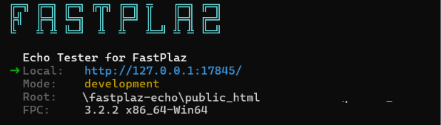

# ECHO Tester with FastPlaz

### Live Echo Tester

Try echo site : 
[http://echo.fastplaz.com/?var1=value1&var2=value2](http://echo.fastplaz.com/?var1=value1&var2=value2)

You can use GET, POST, PUT, PATCH or DELETE method.

Echo returns, as JSON:

- the query string (`GET`)
- form fields (`POST`), also for PUT, PATCH and DELETE
- the raw body (`RAW_BODY`): as is when it is JSON, base64 encoded otherwise
- the request `method` (all methods except GET)

```
$ curl -X PUT -d "name=luri" "http://127.0.0.1:17845/?id=1"
{ "code" : 0, "sitename" : "Echo Tester for FastPlaz", "method" : "PUT", "GET" : { "id" : "1" }, "POST" : { "name" : "luri" }, "RAW_BODY" : "bmFtZT1sdXJp", "time" : "0ms" }
```

## RUN MODES: STANDALONE OR CGI

Echo is built with [FastPlaz](https://github.com/fastplaz/fastplaz) `fastplaz_app`, so **one binary runs in two modes**:

- **Standalone HTTP**: run the binary and it serves HTTP by itself.
- **CGI**: started by Apache/nginx (`GATEWAY_INTERFACE` is set), it runs as a regular CGI program.

### Standalone

```
$ cd public_html
$ ./echo.bin
```



Then open [http://127.0.0.1:17845/?var1=value1](http://127.0.0.1:17845/?var1=value1). Press Ctrl+C to stop.

Settings are read from `public_html/config/config.json`:

```json
"systems" : {
  "trust_proxy" : false,
  "server" : {
    "mode" : "http",
    "address" : "127.0.0.1",
    "port" : 17845,
    "static" : false,
    "max_requests" : 0,
    "db_persistent" : false,
    "db_idle_timeout" : 300
  }
}
```

Command line options override the file: `--mode=cgi|http`, `--port=`, `--address=`, `--static=on|off`, `--max-requests=N`, `--root=<dir>`.

Behind a reverse proxy (nginx/Apache), keep `address` at `127.0.0.1` and set `trust_proxy` to `true`. See [Standalone HTTP Mode – Deployment](https://github.com/fastplaz/fastplaz/blob/master/docs/STANDALONE-deployment.md) for nginx, Apache, systemd and Windows service examples.

### CGI

The included `public_html/.htaccess` routes every request to `echo.bin` on Apache with `mod_cgi` and `mod_rewrite`. See [TRY THIS FIRST](#try-this-first) below.

## BUILD FROM SOURCE

Requirements: [Free Pascal](https://www.freepascal.org/) 3.2.2 or newer and the [FastPlaz](https://github.com/fastplaz/fastplaz) source.

`source/echo/extra.cfg` expects FastPlaz in `vendors/fastplaz`, next to this repository:

```
projects/
  echo/            <- this repository
  vendors/
    fastplaz/      <- https://github.com/fastplaz/fastplaz
```

Edit the `-Fu../../../vendors/fastplaz/...` lines in `extra.cfg` if yours is elsewhere.

Compile:

```
$ cd source/echo
$ ./build.sh
```

`build.sh` creates the unit output directory `lib/<cpu>-<os>/` and runs `fpc echo.lpr @extra.cfg`. When you call `fpc` directly, create that directory first (e.g. `lib/x86_64-win64` or `lib/x86_64-linux`). The binary is written to `public_html/echo.bin`.

With Lazarus, open `source/echo/echo.lpi` (requires the `fastplaz_runtime` package).

## TRY THIS FIRST

For you guys that want to try fastplaz without need to compile, download this file:
[http://echo.fastplaz.com/files/echo.zip](http://echo.fastplaz.com/files/echo.zip)

Same content with this repository, but just have 1 additional binary file for linux environment.

Follow this step:

1. Upload all files in folder 'public\_html/' to your website's homedir.
if you use cpanel hosting, usually in folder '/home/username/public\_html/'


2. Make write permission to folder 'ztemp/', ex:
```chmod -R 777 ztemp/```

then try access from your browser with this format url:

[http://yourdomain/?var1=value1&var2=value2](http://yourdomain/?var1=value1&var2=value2)

The result should be like this:

from browser:


using curl from console:


using postman:


## DEPLOY WITH DOCKER

It is easy to deploy this project via Docker. We have prepared [FastPlaz image in docker hub](https://hub.docker.com/u/fastplaz/).

**Follow this step:**

Build docker image:

```
# cd docker
# ./build.sh
```

if successfull, run container:

```
# ./run.sh
```

then you should see this result


## References

- [FastPlaz Documentation](https://fastplaz.github.io)
- [Tutorial Build FastPlaz Echo Project with Docker](https://medium.com/@luridarmawan/build-fastplaz-echo-project-with-docker-1271aea5f04d)


Semangat ....!
